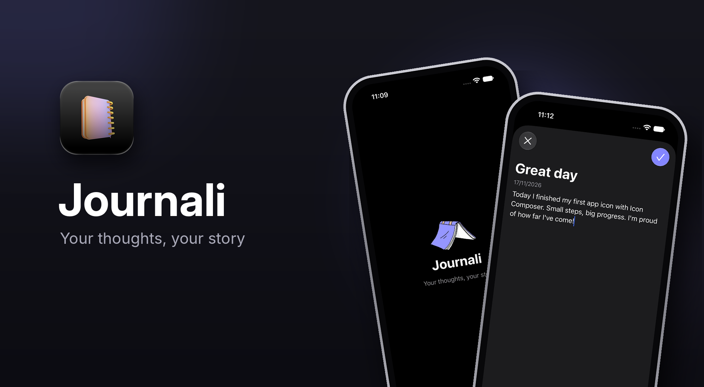

# Journali
Your thoughts, your story — a simple journal app for iPhone.

## Features
- Add, edit and delete journals
- Bookmark your favorite journals
- Sort by bookmark or by date
- Search by title or content
- Light and Dark mode
- Liquid Glass design
- App icon made with Icon Composer

## Tech
- **Swift**
- **SwiftUI**
- **MVVM** (Model – View – ViewModel)

## Project Structure
- **Journal Model** → `JournalEntry`
- **Journal ViewModel** → `JournalViewModel`
- **Journal View** → `MainPageView`, `JournalEditorView`, `Splash`
- **Component** → `JournalCard`, `Theme`

## How to Run
1. Open `HelloWorldChallenge.xcodeproj` in Xcode
2. Choose an iPhone simulator
3. Press **Cmd + R**

## Screenshots

